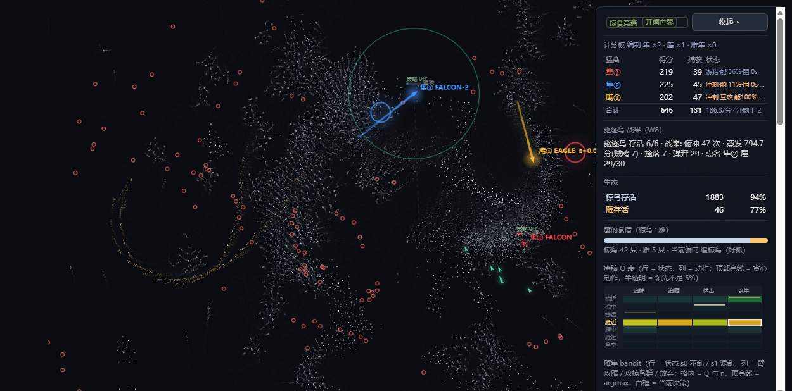

# 鸟群掠食竞赛 · Boids Predation Sim

> 单文件、零依赖的实时 **椋鸟群涌现 × 猛禽掠食** 仿真：拓扑邻居 boids、雁群 V 编队、
> 隼的链式攻击与双隼配合、鹰的 Q-learning、雁隼的上下文赌博机、驱逐鸟的负外部性，
> 外加 WebGPU 计算后端 / WebGL 实例化渲染 / 可选的纯 2D 变体。
> **双击 HTML 即可运行**，无需构建、无需服务器。



---

## 快速开始

| 你想做什么 | 打开哪个文件 |
|---|---|
| **完整体验**（3D/重力 + 全部机制） | `掠食竞赛(4).html` |
| **纯 2D 版**（无 3D/重力，保留全部 AI 与机制） | `掠食竞赛_2D.html` |
| 主线版本（第 8 轮：世界解耦/边界厌恶/惊飞接力波/雁隼/隼猎雁） | `掠食竞赛.html` |
| W5 之前的历史基线（对照用） | `掠食竞赛(3).html` |
| 早期 WebGPU 专项版 | `掠食竞赛-webgpu.html` |

URL 参数：`?compute=cpu|gpu|auto`（计算后端）、`?render=2d`（强制 Canvas2D 全路径）、
`?grav=0`（关重力，与 2D 版物理逐位一致的守恒线）。

面板可随时：加入隼（F）/ 加入鹰（E）/ 加入雁隼（G）、**驱逐鸟数量 −/＋**、
切换计算后端、收起侧栏。

## 文件与版本

| 文件 | 大小 | 说明 |
|---|---|---|
| `掠食竞赛(4).html` | 438.9 KB | **W6–W9 完整版**：隼链式攻击、双隼配合四件套、雁隼 bandit、驱逐鸟；保留 3D/重力/WebGL3D |
| `掠食竞赛_2D.html` | 413.4 KB | **2D 变体**：删除 3D 视角层与全部 z 动力学，保留 WebGPU 计算后端与全部 AI；与 `(4)?grav=0` 物理逐位一致 |
| `掠食竞赛.html` | 344.6 KB | 主线第 8 轮：世界 3200×2200 与视口解耦、边界"厌恶值"、惊飞接力波、雁隼、隼猎雁 + 更长冲刺 + 垂向末制导 |
| `掠食竞赛(3).html` | 336.8 KB | W6–W9 施工单的冻结基线（含 W5 雁隼削弱/失速） |
| `掠食竞赛-webgpu.html` | 178.5 KB | 早期 WebGPU 计算专项版 |

## 机制总览（按开发轮次）

- **第 1–5 轮**：拓扑 boids（每只只看最近 7 只）、雁群 V 编队、隼的能量轮换/拦截位、
  鹰的 Q-learning 猎物偏好、局部视野、计分板；物理基准 → 零分配热循环 → **WebGL 实例化渲染**。
  详见 [README-original.md](README-original.md)（561 行完整开发记录）。
- **第 6–8 轮（主线）**：
  - **世界与视口解耦**：世界 3200×2200 / 视口 1280×720，相机跟随鸟群；
  - **边界"厌恶值"**：没有墙、不环绕，距边 420px 内被饱和力柔和推回 + 削掉朝外速度分量，
    实测 `clampCount=0`、个体到边最近 260~340px；
  - **惊飞接力波**：W2 惊飞状态机 + 行为传染 + 不应期，可量化极化度/波传播距离；
  - **隼的冲刺修正**：能量/回能、俯冲相、末制导；
  - **雁隼（新物种）**：单次攻击 + 300 帧冷却、专攻大雁；
  - **隼猎雁 + 更长冲刺 + 冲刺中横向/垂向微调**。
- **W6–W9 施工单（`掠夺竞赛(4).html` / `_2D.html`）**：
  - **W6 隼·链式攻击**：冲刺中每 3 帧动态再锁定（60px/45° 锥），一次冲刺连续吃多只，
    能耗递增 1.5^n + 每口账面能耗封顶、吃到雁立即"大餐收尾"；
  - **W6b 配合四件套**：前置追踪拦截位（ES 学到 p7）、牧羊位、帧级共享感知、事件双打；
    同盟豁免（隼-隼不再抢分/扣分）；
  - **W7 雁隼 bandit**：2 状态 × 3 臂 UCB1 + softmax，奖励 雁+100/椋鸟+1/落空−4，
    学到权重取代硬编码偏好；面板实时 2×3 表；
  - **W8 驱逐鸟**：6 只纯负外部性物种，贴身高分猛禽叠层 → 转向/能耗 debuff、
    层满俯冲蒸发分数（分数"蒸发"不进任何口袋）；面板可 −/＋ 控数量、可整群开关；
  - **W9 纯 2D 变体**：删 3D 与全部 z 动力学（不是留 `if(GRAV_ON)`），保留 WebGPU 第三块脚本。

## 验收与守恒线

`dev/` 下保留了完整的验收脚本（Node + jsdom，无需浏览器）：

```
node dev/checks/headless.mjs            # 主逻辑不变量
node dev/w6w9/t4_final_suite.mjs "掠食竞赛(4).html"   # W6–W9 全量验收（双臂 + 冻结守卫）
node dev/w6w9/t5_conserve.mjs 2000 11,22,33           # 守恒线：2D 与 (4)?grav=0 逐位对比
```

**守恒线**（2D 变体必须与完整版的 `?grav=0` 物理逐位一致）：固定种子 2000 帧，
`physicsHash` = `f1939905`(11) / `5d7bc120`(22) / `48af6cbe`(33)。
删除 z 代码时**必须保留所有 `Math.random()` 调用**（包括已无人读的），否则随机数流改变、守恒立即失败。

验收总表见 [docs/W6-W9_验收总表.md](docs/W6-W9_验收总表.md)（PASS 29 / FAIL 3，3 条 FAIL 均带归因：
判据天花板/判据口径/设计交互，非实现缺陷）；各任务报告见 `docs/`。

## 目录结构

```
掠食竞赛.html / (3).html / (4).html / _2D.html / -webgpu.html   ← 五个可独立运行的版本
README.md                  ← 本文件
README-original.md         ← 561 行开发记录（第 1–5 轮细节）
docs/                      ← 任务报告、验收总表、截图
dev/checks/                ← 主逻辑不变量与探针脚本
dev/patches/               ← 逐处精确锚点的补丁脚本（可幂等重跑）
dev/w6w9/                  ← W6–W9 的验收/诊断脚本（jsdom）
```

## 已知缺口 / 未验证项（诚实清单）

- 浏览器真机路径只在 Edge headless 下验证过（Canvas2D 与 WebGL 两条路径均 0 报错、非空白）；
  Firefox/Safari 未测。
- 验收总表 3 条 FAIL：T2 的 A1（对照组命中率贴 1.000 天花板，判据不可达）、
  T3 的目标命中率（全群口径 60.3% < 70%，既有缺陷）、T1 的 `dashMaxEats≤8` 在 T1b 隔离臂不成立（设计交互）。
- `stats.ghunterMiss` 未区分"落空/被打断"；`hunterDetail` 无 `stall` 字段；隼无分物种食谱统计。

## 许可

未指定许可证；如需开源授权请告知（默认保留所有权利）。
